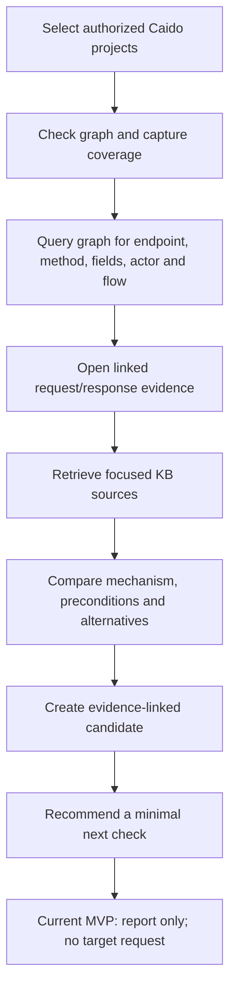

# Graph-guided vulnerability analysis

## Product behavior

The graph is the assistant's primary map for navigating observed application
behavior. It is not a vulnerability verdict and does not authorize network
actions. The assistant follows graph relationships to choose which recorded
exchanges to inspect, then uses the KB to ground a concrete hypothesis.

## Analysis loop

1. **Choose the data boundary.** Work only in the Caido projects selected for
   this analysis. Display their import/coverage state first; missing or
   truncated history is part of the result.
2. **Navigate from graph facts.** Search graph slices for relevant endpoint
   families and relationships: HTTP method, route, parameter names/types,
   response shape, actor/session label, object references, and observed flow
   order. Every returned edge must link to the underlying Caido request IDs and
   capture revision. Search can start from an endpoint/field filter or a keyed
   request/response variant signature. Referer and redirect edges carry their
   match basis: exact normalized URL or route-template fallback. Route-template
   matches are ambiguous navigation context, not proof that one request caused
   another.
3. **Inspect the smallest useful evidence set.** Retrieve the full relevant
   stored exchanges and their context from the local project vault. Do not
   treat a route name, status code, parameter name, or graph path as proof of a
   vulnerability. Keep secrets and sensitive response fields redacted in
   model-visible output.
4. **Ground the mechanism in KB.** Search by the observed behavior and
   suspected mechanism, then read the full applicable source. Record its path,
   version/hash, relevant passage, preconditions, and what would distinguish
   the suspected issue from normal behavior.
5. **Form a candidate, not a verdict.** State observed facts, interpretation,
   evidence references, impact if confirmed, alternative explanations, missing
   context, and the minimal next check. Keep graph facts and KB guidance
   separate from model-generated conclusions.
6. **Keep validation outside the current data-analysis loop.** The MVP may
   recommend a bounded validation step, but does not send it. Any future
   validation mode needs its own program scope, allowed-method and rate policy,
   explicit operator control, target allowlist, and evidence capture path. A
   graph relation or KB playbook cannot grant that permission.

## Graph queries are progressive

Avoid asking the model to dump the whole graph. Start with a coarse query
(asset/endpoint family), inspect the returned slice and coverage, then narrow by
method, fields, actor, response, or flow. Each tool result should include a
stable cursor or bounded result count so the coordinator can continue without
losing provenance. When evidence is ambiguous, return the ambiguity and request
the next smallest slice rather than inventing a relationship.

## Candidate record

Each candidate should contain:

- selected Caido project IDs and coverage status;
- graph entities/edges and exact capture IDs/revisions;
- redacted observed request/response facts;
- KB source IDs, revisions/hashes, and applicable spans;
- suspected mechanism and required preconditions;
- contrasting benign explanation and expected difference;
- impact if confirmed, confidence limits, and unknowns;
- proposed next check and why it is minimal;
- status: `candidate`, `reproducing`, `reproduced`, or `verified`.

Only independent evidence validation may promote a candidate to `verified`.
Graph reachability, a KB match, or a model confidence score cannot do so.
